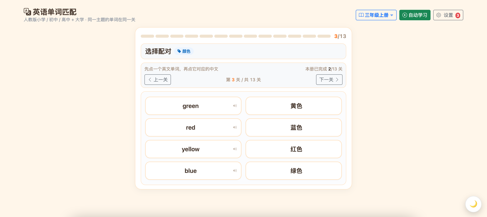

# 单词对对碰

人教版小学 / 初中 / 高中 + 大学四六级词库的**单词配对练习**工具，五端同源：
**网页版（GitHub Pages）** + **微信小程序** + **Android App（Capacitor）** + **iOS App（Capacitor）** + **桌面端（Tauri 2）**，
判分 / 出题 / 音频逻辑逐字节一致。

- **网页版（免安装，即开即玩）**：https://kennethfan.github.io/edu-english/
- **Android APK / iOS IPA / 桌面安装包**：推 `v*` 标签自动打包发布到 [Releases](https://github.com/kennethfan/edu-english/releases)（iOS 为无签名 IPA，需侧载安装；桌面端含 macOS（arm64/x64）/ Windows / Linux 安装包）
- 词库：26 册 · 3442 关 · 13632 词条 · 9085 条发音音频（离线可玩）
- 功能：选册续玩、配对玩法、进度持久化、自动学习（自动配对跟读）、错题本（错词重刷）
- 双主题：儿童模式（暖奶油，默认）/ 深色模式（石墨蓝灰），右下角浮动钮切换

## 产品截图



*儿童模式 · 配对玩法 · 自动学习 · 主题切换（右下角浮钮）*

## 功能介绍

| 功能 | 说明 |
|---|---|
| 📚 选册学习 | 26 册覆盖人教小学 / 初中 / 高中 + 大学四六级，共 3442 关 · 13632 词条，按册按关推进 |
| 🎮 配对玩法 | 先点英文单词再点对应中文，点词即发音；错配锁定 620ms 防连点误触，零错过关记 **perfect** |
| 🔊 发音跟读 | 9085 条发音音频全部离线内置，断网也能听写跟读 |
| 🤖 自动学习 | 一键自动配对 + 跟读，适合课前预习 / 磨耳朵，随时暂停退出 |
| 📝 错题本 | 错词自动收集，支持错词重刷（判分与正卡同源）、单个删除、一键清空 |
| 💾 进度持久化 | 每册每关进度自动保存，重开续玩不丢进度 |
| 🎨 双主题 | 儿童模式（暖奶油，默认）/ 深色模式（石墨蓝灰），右下角浮动钮切换，三端一致 |
| 🔗 五端同源 | 网页版 / 微信小程序 / Android / iOS / 桌面端（Tauri 2）判分、出题、音频逻辑逐字节一致 |

## 仓库结构

```
├── 单词匹配精校版-PEP-CET-全26册.html   # 词库与游戏逻辑的唯一源头（只读，勿改）
│                                         # 位于仓库上级目录 edu/ 下
├── scripts/                             # 构建 / 生成脚本
│   ├── prepare-www.mjs                  #   生成 www/index.html（复制源 HTML + 注入 shim 与主题补丁）
│   ├── theme-patch.css / .js            #   App/网页端双主题补丁（与小程序同 token）
│   ├── make-audio.py                    #   edge-tts 合成发音 → .work/raw（原始 MP3 池）
│   ├── miniapp_extract.py               #   小程序分包装配（关级贪心装箱 + canonical 音频去重）
│   └── gen_meta.py                      #   生成小程序主包元数据（书名册 / 词→包音频归属）
├── miniapp/                             # 微信小程序（M0-M2 全量）
│   ├── core/                            #   pkgs/loaders/game/store/theme/audiomap/books-meta
│   ├── pages/                           #   index（首页）/ books（选册）/ game（配对）/ wrong（错题本）
│   └── packages/b01..b28/               #   分包（data.js + 占位页；audio/ 为生成产物不入库）
├── www/                                 # 网页版 / Android / iOS / 桌面端 的 Web 资产（生成产物）
├── android/                             # Capacitor 8 原生工程
├── ios/                                 # Capacitor 8 原生工程（SPM 模式，无需 CocoaPods）
├── src-tauri/                           # Tauri 2 桌面端工程（frontendDist → ../www）
└── docs/                                # 设计文档 / ADR
```

**网页版发布**：`gh-pages` 分支承载 `www/` 构建产物（index.html + shim.js +
`audio/` 9085 条 ogg），由 GitHub Pages 直接服务，与 master 解耦——master 保持
无音频的干净代码库，网页版更新时重建 gh-pages 分支推送即可。

## 双端架构与同源性

```
源 HTML（__WORD_MATCH_DATA__ 词库 + 游戏逻辑，唯一事实源）
   │
   ├─ scripts/prepare-www.mjs ──► www/index.html（App 端，注入 shim + 主题补丁）
   │                                  └─ Capacitor 打包 → android/ → APK
   └─ scripts/miniapp_extract.py ──► miniapp/packages/（关级粒度装箱成 28 个分包）
                                     core/pkgs.js、loaders.js（静态路径 require.async）
```

- **判分口径**（`sameMeaning`：跨侧按释义相等、同侧退回 key）、错配锁定 620ms、
  零错 = perfect 等规则与 App 线逐字节同源
- **音频 canonical 去重**：每个词的音频只存「首次装到它的分包」，跨包引用
  由 `core/audiomap.js`（词哈希 → 分包）解析；词哈希为双盐 FNV-1a 32（UTF-8 字节），
  三端（源 HTML / App / 小程序）逐字节一致
- **主题**：一套视觉 token 两端共用（`--wm-*` / CSS 变量），kids 默认

## 构建与开发

### 小程序（微信开发者工具）

```bash
# 1. 分包装配（前置：.work/raw 有原始音频池；音频已存在于池中则幂等续传）
python3 scripts/miniapp_extract.py
python3 scripts/gen_meta.py          # 生成 books-meta.js / audiomap.js

# 2. 微信开发者工具打开 miniapp/ 目录即可
# 3. 上传体验版（注意清掉 shell 代理变量，见下）
env -u http_proxy -u https_proxy -u all_proxy \
    -u HTTP_PROXY -u HTTPS_PROXY -u ALL_PROXY \
    /Applications/wechatwebdevtools.app/Contents/MacOS/cli upload \
    --project $(pwd)/miniapp -v 0.1.1 -d "双主题+错题本"
```

包体约束：单分包 < 2M（装配目标 1.5M，`LIMIT` 可调）、总包 < 30M、
主包 < 1.5M（当前 ~250KB，含 222KB 词→包音频归属表）。

### Android App

```bash
node scripts/prepare-www.mjs         # 重生成 www/index.html（幂等）
npx cap sync android                 # www → 原生工程
# Android Studio 打开 android/ 构建 APK
```

### iOS App

```bash
node scripts/prepare-www.mjs
npx cap sync ios                     # www → 原生工程（SPM 模式，无需 CocoaPods）
# Xcode 打开 ios/App/App.xcodeproj 构建运行
```

### 桌面端（Tauri 2）

```bash
node scripts/prepare-www.mjs         # www/ 为 Tauri frontendDist
npm install                          # devDependencies 含 @tauri-apps/cli
npx tauri dev                        # 本地开发调试（需 Rust 工具链）
npx tauri build                      # 产物在 src-tauri/target/release/bundle/
```

### CI 自动打包（Android + iOS + 桌面）

推 `v*` 标签即触发 [release.yml](.github/workflows/release.yml)：

```bash
git tag v0.1.5 && git push origin v0.1.5
```

- Android job（ubuntu）：gh-pages 取音频 → sync → tag 注入 versionName → `assembleDebug` → Release 发 APK
- iOS job（macos）：同源资产 → tag 注入 MARKETING_VERSION → 无签名 `xcodebuild` → Payload 打包 → 同一 Release 追加 IPA
- 桌面 job（macos ×2 / ubuntu / windows 矩阵）：同源资产 → tag 注入 tauri.conf 版本 → `tauri-action` 打包
  - macOS：aarch64 + x86_64 各一个 dmg
  - Windows：NSIS exe + msi
  - Linux：AppImage + deb
- iOS IPA **未签名**（路线 A）：仅可侧载（AltStore / TrollStore）或模拟器安装；有开发者账号后在 CI 配 p12 + 描述文件 secrets 即可出签名包

### 生成产物（不入库，可重建）

`www/`、`www/audio/`、`.work/`（原始合成音频 / 索引 / 断点清单）、
`miniapp/packages/*/audio/` 均在 `.gitignore` 中——克隆后跑上述脚本重建。

## 已知坑（踩过一次就记下）

| 坑 | 处置 |
|---|---|
| IDE 2.x「上传失败：网络请求错误」 | 系统代理（Clash 7890）拦截微信上传通道：IDE 设置→代理→不使用任何代理 |
| CLI 上传 ECONNREFUSED 127.0.0.1:7890 | shell 级代理环境变量指向死端口：命令前加 `env -u …` 清变量 |
| CLI 二维码路径无效 | IDE 沙盒写不了 `/tmp`，`--qr-output` 用项目内路径 |
| `require.async` 找不到模块 | 相对路径以**声明文件所在目录**解析，`core/loaders.js` 应为 `../packages/…` |
| 沙箱/终端批量删除进程被杀 | 装配脚本跑前先 `mv` 旧 `packages` 目录、输出落文件后台执行 |

## 文档

- `docs/miniprogram-plan.md` — 小程序端里程碑规划（M0-M2）
- `docs/adr/` — 关键决策记录
